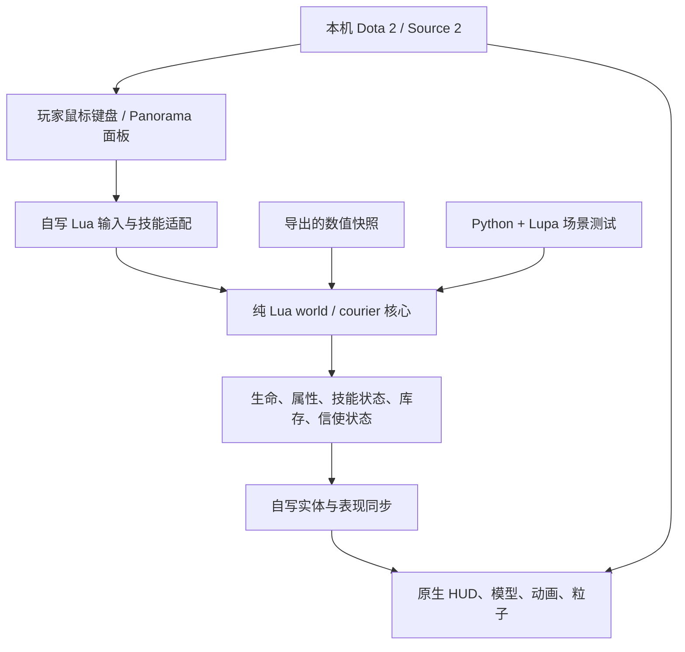

# 技术栈与项目结构

## 技术栈

| 层 | 技术 | 用途 |
| --- | --- | --- |
| 运行宿主 | Dota 2 / Source 2，Windows | 实体、地图、渲染、导航、原生界面与输入 |
| 玩法核心 | Lua | 战斗状态、伤害、技能、物品、生命周期、信使 |
| 引擎适配 | Dota Lua API、ability_lua、modifier | 输入订单转换、实体绑定、表现与核心状态同步 |
| 自定义界面 | Panorama XML / CSS / JavaScript | 测试控制面板与客户端事件 |
| 注册与本地化 | Valve KeyValues、TXT | 自定义单位/技能/物品声明及中英文文本 |
| 构建与启动 | PowerShell、少量内嵌 C# | 文件部署、UI 资源封装、目录联接、带会话标记的引擎检查 |
| 离线验证 | Python 3.12、Lupa 2.8 | 无需启动游戏，直接执行 Lua 玩法场景 |
| 配置工具 | Python、项目内 KV1 解析器、JSON | 提取数值快照与来源哈希 |
| 前期研究 | REA、Ghidra、Unicorn | 局部原生行为证据；不随游戏运行 |

## 目录

```text
.
├── addon/
│   ├── addoninfo.txt             自定义游戏入口声明
│   ├── resource/                中英文显示文本
│   └── scripts/
│       ├── npc/                 单位、技能、物品注册
│       └── vscripts/
│           ├── core/
│           │   ├── world.lua    独立战斗与状态核心
│           │   ├── courier.lua  信使配送状态机
│           │   └── source_values.lua 生成的数值快照
│           ├── addon_game_mode.lua   服务端生命周期、输入和实体同步
│           ├── addon_game_mode_client.lua 客户端入口
│           ├── replica_abilities.lua 技能输入桥
│           ├── replica_items.lua     物品桥
│           ├── replica_modifiers.lua 原生属性/行为适配
│           ├── replica_effects.lua   模型、声音和特效表现
│           ├── replica_courier.lua   信使实体适配
│           └── replica_verify.lua    引擎集成检查
├── ui/                          Panorama 面板
├── tests/                       五组独立 Lua 场景测试的 Python 入口
├── tools/                       测试入口、KV 解析/导出、游戏路径发现
├── docs/                        架构、历程、经验、验证和来源
├── Build.ps1                    本地构建与部署
├── Launch.ps1                   启动及可选集成检查
├── 启动斧王岛.cmd                Windows 快捷入口
├── requirements-dev.txt         离线测试依赖
└── source-values.json           数值原件哈希与 VPK 内部路径
```

运行后生成的 `runtime/`、`verification/` 不进入版本控制；旧研究资料、过程计划、备份也不属于发布内容。

## 数据如何流动



原生英雄实体负责外观和控制承载。原版英雄技能移除后，由本项目的 Lua 技能接收输入；原生伤害过滤器阻止原版伤害再次结算，核心负责维护 HP。地图自动兵线与建筑攻击关闭，避免混入未接管的原版玩法。

原生单位与核心单位是两份相关状态，适配层必须维持一致。死亡由核心控制，其复活流程不是原版完整死亡/买活管线；原生 HUD 可见也不意味着所有内部规则都来自原版。
